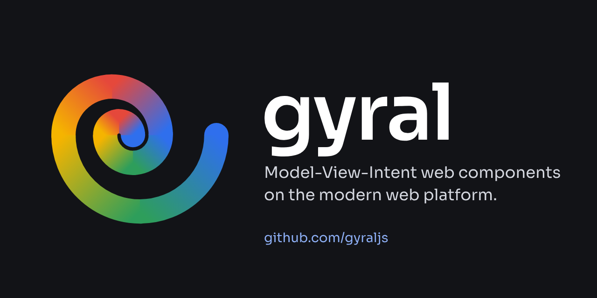

# Gyral brand

Logos, icons and the usage guide for [Gyral](https://gyral.dev), Model-View-Intent web components on the
modern web platform. The framework itself lives in [gyraljs/gyral](https://github.com/gyraljs/gyral).



Read [BRAND.md](BRAND.md) before using the logos. Everything is in [`dist/`](dist/); the
[contact sheet](dist/contact-sheet.png) shows every file at a glance.

## The files you probably want

| For                               | File                                                                                                                                   |
| --------------------------------- | -------------------------------------------------------------------------------------------------------------------------------------- |
| Logo on a light page              | [`gyral-lockup-horizontal-gyral-transparent-light.svg`](dist/lockup-horizontal/gyral-lockup-horizontal-gyral-transparent-light.svg)    |
| Logo on a dark page               | [`gyral-lockup-horizontal-gyral-transparent-dark.svg`](dist/lockup-horizontal/gyral-lockup-horizontal-gyral-transparent-dark.svg)      |
| Mark on its own                   | [`gyral-mark-transparent-light.svg`](dist/mark/gyral-mark-transparent-light.svg), [`-dark`](dist/mark/gyral-mark-transparent-dark.svg) |
| Avatar (GitHub, npm, social)      | [`avatar-mark-500.png`](dist/social/avatar-mark-500.png)                                                                               |
| Link preview (Open Graph)         | [`og-1200x630.png`](dist/social/og-1200x630.png)                                                                                       |
| GitHub repository social preview  | [`github-social-1280x640.png`](dist/social/github-social-1280x640.png)                                                                 |
| Website icons                     | [`dist/web/`](dist/web/): `favicon.ico`, `favicon.svg`, `apple-touch-icon.png`, `site.webmanifest`                                     |
| Print                             | the `.pdf` next to any SVG                                                                                                             |
| One-colour print, engraving, foil | [`gyral-mark-mono-black.pdf`](dist/mark/gyral-mark-mono-black.pdf), [`gyral-mark-mono-white.pdf`](dist/mark/gyral-mark-mono-white.pdf) |
| Screen print, embroidery          | the `flat-*` variants                                                                                                                  |

Website head:

```html
<link rel="icon" href="/favicon.ico" sizes="48x48" />
<link rel="icon" href="/favicon.svg" type="image/svg+xml" />
<link rel="apple-touch-icon" href="/apple-touch-icon.png" />
<link rel="manifest" href="/site.webmanifest" />
```

## Building

```sh
pnpm install
pnpm exec playwright install chromium   # once per machine
pnpm build                              # regenerate dist/ (deterministic)
pnpm check                              # formatting and asset tests
```

The single source is `scripts/brand.mjs` (geometry, colours, layouts); `scripts/build.mjs` renders every file.
Commit `dist/` with the change that produced it. pnpm adopts a dependency version only once it is
two weeks old (`minimumReleaseAge` in `pnpm-workspace.yaml`, Gyral's ADR 0032). The build needs Node 24
or later and pnpm 12 (`packageManager` in `package.json`). A Playwright update brings a new Chromium,
which rewrites the `Producer` line of every PDF.

## Licence

The logos are trademarks and are not openly licensed — see [BRAND.md](BRAND.md#licence-and-usage-policy) for what
you can do without asking (most things that refer to Gyral honestly) and [LICENSE](LICENSE). The build scripts
are MIT. Sora is under the SIL Open Font License.
